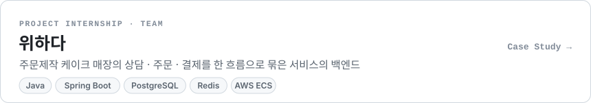
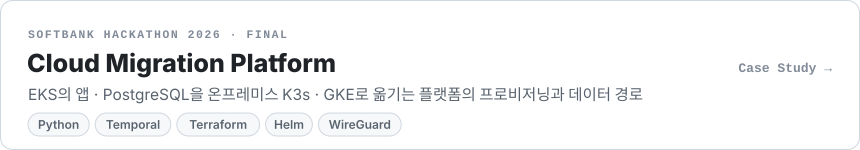
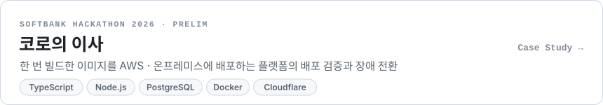

<a href="https://kmsdevdata-sketch.github.io">
  <picture>
    <source media="(prefers-color-scheme: dark)" srcset="https://github.com/kmsdevdata-sketch/kmsdevdata-sketch/raw/main/assets/svg/header-dark.svg">
    
  </picture>
</a>

  
  
  

주문·결제 서비스부터 클라우드 배포와 데이터 이전까지, 기능이 동작하는 것을 넘어 **안전하게 동작한다는 근거**를 만드는 데 집중해 왔습니다.

## Featured Projects

<a href="https://kmsdevdata-sketch.github.io/projects/wihada.html">
  <picture>
    <source media="(prefers-color-scheme: dark)" srcset="https://github.com/kmsdevdata-sketch/kmsdevdata-sketch/raw/main/assets/svg/project-wihada-dark.svg">
    
  </picture>
</a>

[Case Study](https://kmsdevdata-sketch.github.io/projects/wihada.html) · [Code](https://github.com/kmsdevdata-sketch/wihada-api) · [Blog: 쿼리 최적화](https://www.beingbe.tech/posts/query-optimization/query-optimization-1/) · [Blog: 트랜잭션 & 동시성](https://www.beingbe.tech/posts/transaction-concurrency/transaction-concurrency-1/)

<a href="https://kmsdevdata-sketch.github.io/projects/jackal.html">
  <picture>
    <source media="(prefers-color-scheme: dark)" srcset="https://github.com/kmsdevdata-sketch/kmsdevdata-sketch/raw/main/assets/svg/project-jackal-dark.svg">
    
  </picture>
</a>

[Case Study](https://kmsdevdata-sketch.github.io/projects/jackal.html) · [Code](https://github.com/SoftBank-Hackathon-2026-Team-Jackal/cloud-migration-platform) · [Blog: 클라우드 마이그레이션](https://www.beingbe.tech/posts/cloud-migration/cloud-migration-1/)

<a href="https://kmsdevdata-sketch.github.io/projects/koro-moving.html">
  <picture>
    <source media="(prefers-color-scheme: dark)" srcset="https://github.com/kmsdevdata-sketch/kmsdevdata-sketch/raw/main/assets/svg/project-koro-dark.svg">
    
  </picture>
</a>

[Case Study](https://kmsdevdata-sketch.github.io/projects/koro-moving.html) · [Code](https://github.com/2026-Softbank-hackathon/Auto-Deployment-System)

**Other Projects** · [OneAsset](https://kmsdevdata-sketch.github.io/projects/oneasset.html) — API 하나로 이미지 저장·변환·CDN 배포, k6로 실제 환경 한계 측정 · [Pium](https://kmsdevdata-sketch.github.io/projects/pium.html) — SWYP 팀 프로젝트를 혼자 재설계해 출시한 피부 진단 서비스

## Writing

- [쿼리 최적화 시리즈](https://www.beingbe.tech/posts/query-optimization/query-optimization-1/) — 측정 → 실행 계획 분석 → N+1 제거
- [트랜잭션 & 동시성 시리즈](https://www.beingbe.tech/posts/transaction-concurrency/transaction-concurrency-1/) — 결제 승인과 내부 트랜잭션의 경계, 동시 승인 재현과 복구
- [클라우드 마이그레이션 1편](https://www.beingbe.tech/posts/cloud-migration/cloud-migration-1/) — NAT 뒤 온프레미스로 PostgreSQL 논리 복제하기

## Tech Stack

**Backend**  
   

**Data**  
  

**Infra**  
  

## Certifications

