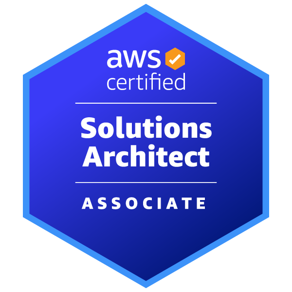

### 안녕하세요, 백엔드 개발자 김민서입니다!

최근에는 오픈소스 기여를 위해 작은 기여를 차근차근 쌓아 나가고 있습니다!

 

## Projects

<a href="https://github.com/kmsdevdata-sketch/wihada-api"><picture><source media="(prefers-color-scheme: dark)" srcset="https://socialify.git.ci/kmsdevdata-sketch/wihada-api/png?description=1&amp;descriptionEditable=%EC%A3%BC%EB%AC%B8%EC%A0%9C%EC%9E%91%20%EC%BC%80%EC%9D%B4%ED%81%AC%20%EB%A7%A4%EC%9E%A5%EC%9D%98%20%EC%83%81%EB%8B%B4%C2%B7%EC%A3%BC%EB%AC%B8%C2%B7%EA%B2%B0%EC%A0%9C%20%EB%B0%B1%EC%97%94%EB%93%9C&amp;font=Inter&amp;language=1&amp;logo=https%3A%2F%2Fcdn.jsdelivr.net%2Fgh%2Fdevicons%2Fdevicon%40v2.16.0%2Ficons%2Fspring%2Fspring-original.svg&amp;name=1&amp;pattern=Transparent&amp;theme=Dark"></picture></a> <a href="https://github.com/SoftBank-Hackathon-2026-Team-Jackal/cloud-migration-platform"><picture><source media="(prefers-color-scheme: dark)" srcset="https://socialify.git.ci/SoftBank-Hackathon-2026-Team-Jackal/cloud-migration-platform/png?description=1&amp;descriptionEditable=EKS%20%EC%84%9C%EB%B9%84%EC%8A%A4%EB%A5%BC%20%EC%98%A8%ED%94%84%EB%A0%88%EB%AF%B8%EC%8A%A4%20K3s%C2%B7GKE%EB%A1%9C%20%EC%98%AE%EA%B8%B0%EB%8A%94%20%ED%94%8C%EB%9E%AB%ED%8F%BC&amp;font=Inter&amp;language=1&amp;logo=https%3A%2F%2Fcdn.jsdelivr.net%2Fgh%2Fdevicons%2Fdevicon%40v2.16.0%2Ficons%2Ffastapi%2Ffastapi-original.svg&amp;name=1&amp;pattern=Transparent&amp;theme=Dark"></picture></a> <a href="https://github.com/2026-Softbank-hackathon/Auto-Deployment-System"><picture><source media="(prefers-color-scheme: dark)" srcset="https://socialify.git.ci/2026-Softbank-hackathon/Auto-Deployment-System/png?description=1&amp;descriptionEditable=%ED%95%9C%20%EB%B2%88%20%EB%B9%8C%EB%93%9C%ED%95%9C%20%EC%9D%B4%EB%AF%B8%EC%A7%80%EB%A5%BC%20AWS%C2%B7%EC%98%A8%ED%94%84%EB%A0%88%EB%AF%B8%EC%8A%A4%EC%97%90%20%EB%B0%B0%ED%8F%AC&amp;font=Inter&amp;language=1&amp;logo=https%3A%2F%2Fcdn.jsdelivr.net%2Fgh%2Fdevicons%2Fdevicon%40v2.16.0%2Ficons%2Fnodejs%2Fnodejs-original.svg&amp;name=1&amp;pattern=Transparent&amp;theme=Dark"></picture></a>

<a href="https://github.com/kmsdevdata-sketch/oneasset-api"><picture><source media="(prefers-color-scheme: dark)" srcset="https://socialify.git.ci/kmsdevdata-sketch/oneasset-api/png?description=1&amp;descriptionEditable=API%20%ED%95%98%EB%82%98%EB%A1%9C%20%EC%9D%B4%EB%AF%B8%EC%A7%80%20%EC%A0%80%EC%9E%A5%C2%B7%EB%B3%80%ED%99%98%C2%B7CDN%20%EB%B0%B0%ED%8F%AC&amp;font=Inter&amp;language=1&amp;logo=https%3A%2F%2Fcdn.jsdelivr.net%2Fgh%2Fdevicons%2Fdevicon%40v2.16.0%2Ficons%2Fspring%2Fspring-original.svg&amp;name=1&amp;pattern=Transparent&amp;theme=Dark"></picture></a> <a href="https://github.com/kmsdevdata-sketch/pium-api"><picture><source media="(prefers-color-scheme: dark)" srcset="https://socialify.git.ci/kmsdevdata-sketch/pium-api/png?description=1&amp;descriptionEditable=%ED%94%BC%EB%B6%80%20%EC%A7%84%EB%8B%A8%EA%B3%BC%20%EC%83%81%ED%92%88%20%EC%B6%94%EC%B2%9C%20%EC%84%9C%EB%B9%84%EC%8A%A4&amp;font=Inter&amp;language=1&amp;logo=https%3A%2F%2Fcdn.jsdelivr.net%2Fgh%2Fdevicons%2Fdevicon%40v2.16.0%2Ficons%2Fspring%2Fspring-original.svg&amp;name=1&amp;pattern=Transparent&amp;theme=Dark"></picture></a>

<b>위하다</b> · <a href="https://www.beingbe.tech/posts/query-optimization/query-optimization-1/">쿼리 최적화</a> · <a href="https://www.beingbe.tech/posts/transaction-concurrency/transaction-concurrency-1/">트랜잭션과 동시성</a>
&nbsp;|&nbsp;
<b>Cloud Migration Platform</b> · <a href="https://www.beingbe.tech/posts/cloud-migration/cloud-migration-1/">클라우드 마이그레이션</a>

 

## Open Source

| 프로젝트 | 기여 내용 | 상태 | 관련 글 |
|:---:|:---|:---:|:---:|
| [JUnit](https://github.com/junit-team/junit-framework/pull/6281) | Jupiter 생명주기 메서드 사이에서도 테스트 취소를 확인하도록 개선 | ✅ [Merged](https://github.com/junit-team/junit-framework/pull/6281) | [1편](https://www.beingbe.tech/posts/oss/junit-contribution-1/) · [2편](https://www.beingbe.tech/posts/oss/junit-contribution-2/) · [3편](https://www.beingbe.tech/posts/oss/junit-contribution-3/) |
| [Hibernate ORM](https://github.com/hibernate/hibernate-orm/pull/14057) | 선언한 결과 타입과 맞지 않는 서브쿼리 select를 미리 거부 | [리뷰 대기](https://github.com/hibernate/hibernate-orm/pull/14057) | [1편](https://www.beingbe.tech/posts/oss/hibernate-contribution-1/) |
| [Jetty](https://github.com/jetty/jetty.project/pull/16207) | 가상 스레드를 쓰면서 생성 수를 제한하는 QueuedThreadPool 설정 방법을 문서화 | [리뷰 대기](https://github.com/jetty/jetty.project/pull/16207) | [1편](https://www.beingbe.tech/posts/oss/jetty-contribution-1/) · [2편](https://www.beingbe.tech/posts/oss/jetty-contribution-2/) |

 

## Tech Stack

 

 

 

## Certifications

 

## Writing

[Spring AOP 동작 원리와 @Transactional의 내부 흐름](https://www.beingbe.tech/posts/spring/spring-aop-proxy-and-transactional/) 
[CKA 학습: Kubernetes 클러스터 구조와 핵심 컴포넌트](https://www.beingbe.tech/posts/kubernetes/kubernetes-cluster-components/) 
[K-클라우드 핵심 인프라 및 오픈소스 SW 기술 세미나 후기](https://www.beingbe.tech/posts/seminar/k-cloud-core-infrastructure-and-open-source-software-technology/)

