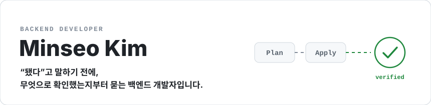
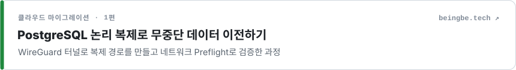

<a href="https://kmsdevdata-sketch.github.io"><picture><source media="(prefers-color-scheme: dark)" srcset="https://github.com/kmsdevdata-sketch/kmsdevdata-sketch/raw/main/assets/svg/header-dark.svg"></picture></a>

<a href="https://kmsdevdata-sketch.github.io"><picture><source media="(prefers-color-scheme: dark)" srcset="https://github.com/kmsdevdata-sketch/kmsdevdata-sketch/raw/main/assets/svg/btn-portfolio-dark.svg"></picture></a> <a href="https://beingbe.tech/"><picture><source media="(prefers-color-scheme: dark)" srcset="https://github.com/kmsdevdata-sketch/kmsdevdata-sketch/raw/main/assets/svg/btn-blog-dark.svg"></picture></a> <a href="mailto:kms.dev.data@gmail.com"><picture><source media="(prefers-color-scheme: dark)" srcset="https://github.com/kmsdevdata-sketch/kmsdevdata-sketch/raw/main/assets/svg/btn-email-dark.svg"></picture></a>

주문·결제 서비스부터 클라우드 배포와 데이터 이전까지, 기능이 동작하는 것을 넘어 **안전하게 동작한다는 근거**를 만드는 데 집중해 왔습니다.

## Projects

<a href="https://github.com/kmsdevdata-sketch/wihada-api"><picture><source media="(prefers-color-scheme: dark)" srcset="https://socialify.git.ci/kmsdevdata-sketch/wihada-api/png?description=1&amp;descriptionEditable=%EC%A3%BC%EB%AC%B8%EC%A0%9C%EC%9E%91%20%EC%BC%80%EC%9D%B4%ED%81%AC%20%EB%A7%A4%EC%9E%A5%EC%9D%98%20%EC%83%81%EB%8B%B4%C2%B7%EC%A3%BC%EB%AC%B8%C2%B7%EA%B2%B0%EC%A0%9C%20%EB%B0%B1%EC%97%94%EB%93%9C&amp;font=Inter&amp;language=1&amp;name=1&amp;pattern=Transparent&amp;theme=Dark"></picture></a> <a href="https://github.com/SoftBank-Hackathon-2026-Team-Jackal/cloud-migration-platform"><picture><source media="(prefers-color-scheme: dark)" srcset="https://socialify.git.ci/SoftBank-Hackathon-2026-Team-Jackal/cloud-migration-platform/png?description=1&amp;descriptionEditable=EKS%20%EC%84%9C%EB%B9%84%EC%8A%A4%EB%A5%BC%20%EC%98%A8%ED%94%84%EB%A0%88%EB%AF%B8%EC%8A%A4%20K3s%C2%B7GKE%EB%A1%9C%20%EC%98%AE%EA%B8%B0%EB%8A%94%20%ED%94%8C%EB%9E%AB%ED%8F%BC&amp;font=Inter&amp;language=1&amp;name=1&amp;pattern=Transparent&amp;theme=Dark"></picture></a>

<a href="https://github.com/2026-Softbank-hackathon/Auto-Deployment-System"><picture><source media="(prefers-color-scheme: dark)" srcset="https://socialify.git.ci/2026-Softbank-hackathon/Auto-Deployment-System/png?description=1&amp;descriptionEditable=%ED%95%9C%20%EB%B2%88%20%EB%B9%8C%EB%93%9C%ED%95%9C%20%EC%9D%B4%EB%AF%B8%EC%A7%80%EB%A5%BC%20AWS%C2%B7%EC%98%A8%ED%94%84%EB%A0%88%EB%AF%B8%EC%8A%A4%EC%97%90%20%EB%B0%B0%ED%8F%AC&amp;font=Inter&amp;language=1&amp;name=1&amp;pattern=Transparent&amp;theme=Dark"></picture></a> <a href="https://github.com/kmsdevdata-sketch/oneasset-api"><picture><source media="(prefers-color-scheme: dark)" srcset="https://socialify.git.ci/kmsdevdata-sketch/oneasset-api/png?description=1&amp;descriptionEditable=API%20%ED%95%98%EB%82%98%EB%A1%9C%20%EC%9D%B4%EB%AF%B8%EC%A7%80%20%EC%A0%80%EC%9E%A5%C2%B7%EB%B3%80%ED%99%98%C2%B7CDN%20%EB%B0%B0%ED%8F%AC&amp;font=Inter&amp;language=1&amp;name=1&amp;pattern=Transparent&amp;theme=Dark"></picture></a>

<a href="https://github.com/kmsdevdata-sketch/pium-api"><picture><source media="(prefers-color-scheme: dark)" srcset="https://socialify.git.ci/kmsdevdata-sketch/pium-api/png?description=1&amp;descriptionEditable=%ED%94%BC%EB%B6%80%20%EC%A7%84%EB%8B%A8%EA%B3%BC%20%EC%83%81%ED%92%88%20%EC%B6%94%EC%B2%9C%20%EC%84%9C%EB%B9%84%EC%8A%A4&amp;font=Inter&amp;language=1&amp;name=1&amp;pattern=Transparent&amp;theme=Dark"></picture></a>

각 프로젝트의 문제 정의, 설계 판단, 검증 과정은 포트폴리오에 정리했습니다. <a href="https://kmsdevdata-sketch.github.io"><picture><source media="(prefers-color-scheme: dark)" srcset="https://github.com/kmsdevdata-sketch/kmsdevdata-sketch/raw/main/assets/svg/btn-portfolio-dark.svg"></picture></a>

## Writing

<a href="https://www.beingbe.tech/posts/query-optimization/query-optimization-1/"><picture><source media="(prefers-color-scheme: dark)" srcset="https://github.com/kmsdevdata-sketch/kmsdevdata-sketch/raw/main/assets/svg/post-query-dark.svg"></picture></a>

<a href="https://www.beingbe.tech/posts/transaction-concurrency/transaction-concurrency-1/"><picture><source media="(prefers-color-scheme: dark)" srcset="https://github.com/kmsdevdata-sketch/kmsdevdata-sketch/raw/main/assets/svg/post-tx-dark.svg"></picture></a>

<a href="https://www.beingbe.tech/posts/cloud-migration/cloud-migration-1/"><picture><source media="(prefers-color-scheme: dark)" srcset="https://github.com/kmsdevdata-sketch/kmsdevdata-sketch/raw/main/assets/svg/post-migration-dark.svg"></picture></a>

## Tech Stack

**Backend**  
   

**Data**  
  

**Infra**  
  

## Certifications

